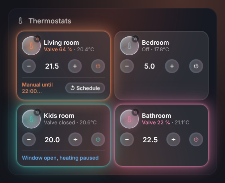

# Thermostat Glass Card

A frosted-glass ("Liquid Glass") styled thermostat widget for Home Assistant
(`custom:thermostat-glass-card`). Displays multiple `climate` entities as a grid of tiles
with plus/minus stepper controls and a power toggle.



## Installation

### HACS (custom repository)

1. HACS → the "⋮" menu (top right) → **Custom repositories**.
2. Add this repository's URL, category **Dashboard**.
3. Install **Thermostat Glass Card**, then add the resource if HACS doesn't do it automatically:
   - Settings → Dashboards → Resources → **+ Add resource**
   - URL: `/hacsfiles/liquid-glass-thermostat/thermostat-glass-card.js`
   - Type: **JavaScript Module**

### Manual

1. Copy `thermostat-glass-card.js` into `<config>/www/`.
2. Settings → Dashboards → Resources → **+ Add resource**
   - URL: `/local/thermostat-glass-card.js`
   - Type: **JavaScript Module**

## Configuration

```yaml
type: custom:thermostat-glass-card
title: Thermostats
entities:
  - entity: climate.living_room
    name: Living Room
    icon_color: teal
  - climate.bathroom
step: 0.5
```

### Card-level options

| Option | Type | Default | Description |
|---|---|---|---|
| `entities` | list | — | **Required.** List of `climate` entity IDs, or objects (see below) |
| `step` | number | `0.5` | Step size per plus/minus tap |
| `title` | string | `"Thermostats"` | Card title |
| `show_title` | boolean | `true` | Show/hide the title |
| `bg_opacity` | number | `0.045` | Button background opacity |
| `blur` | number | `16` | Backdrop blur in px |
| `saturate` | number | `160` | Backdrop saturation % |
| `tile_shade` | number | `15` | Tile background brightness, -100 (darker) to 100 (lighter) |
| `panel_shade` | number | `6` | Panel background brightness, -100 (darker) to 100 (lighter) |
| `demand_threshold` | number | `10` | Valve opening (%) from which a tile counts as "heating" (badge and valve text light up) |

### Per-entity options (inside `entities`)

| Option | Type | Description |
|---|---|---|
| `entity` | string (required) | Climate entity ID |
| `name` | string | Overrides the friendly name |
| `icon_color` | string | Named color (e.g. `teal`, `deep-orange`) or hex, used for the active-state glow/tint |
| `off_temperature` | number | Temperature treated as "off" (defaults to the entity's `min_temp`) |
| `default_on_temperature` | number | Fallback when turning back on. The power button normally restores the last target this browser saw before switching off (default `21`) |
| `demand_entity` | string | Valve-opening sensor in %. Defaults to `sensor.<climate_object_id>_pi_heating_demand` (e.g. Danfoss Ally via Zigbee2MQTT); without one the tile just shows "Heating"/"Off" |
| `status_entity` | string | Optional status line under the tile (2 lines, tap to expand) |
| `reset_when` | string | Status text prefix that marks a manual override (default `Manuell` / `Manual` by HA language); highlighted and offers a reset chip |
| `reset_action` | object | Action for the reset chip, e.g. `{ action: script.resume_schedule, data: {...} }` |
| `reset_label` | string | Chip label (default `↺ Plan` / `↺ Schedule`) |
| `window_prefix` | string | Status text prefix shown in blue (default `Fenster` / `Window`) |

## Theme variables

Like the other Liquid Glass cards, this card reads two optional CSS variables, so one theme can align all of them:

```yaml
# in your Home Assistant theme
lg-radius: 22px                          # corner radius of the glass panel
lg-backdrop: blur(22px) saturate(180%)   # blur/saturation behind the panel
```

Without them nothing changes. Options set on the card itself (e.g. `blur`) still win.

## Changelog

### 1.1.0
- Reads the optional theme variables `--lg-radius` and `--lg-backdrop` (see *Theme variables*).
- Valve opening per tile ("Valve 64 %"), from `demand_entity` or the Zigbee2MQTT `_pi_heating_demand` sensor; `demand_threshold` decides when a tile counts as heating.
- Optional status line (`status_entity`) with a reset chip for manual overrides (`reset_when`, `reset_action`, `reset_label`) and blue window hints (`window_prefix`).
- Power button restores the last target temperature instead of a fixed value.
- Texts follow the Home Assistant language (German/English).
- Fixed: `tile_shade` had no effect.
- Only re-renders when one of the card's own entities changes; names and texts are HTML-escaped.

## License

MIT.

## Credits

Built iteratively in conversation with Claude (Anthropic) against a real Home Assistant dashboard,
then cleaned up for public release.
